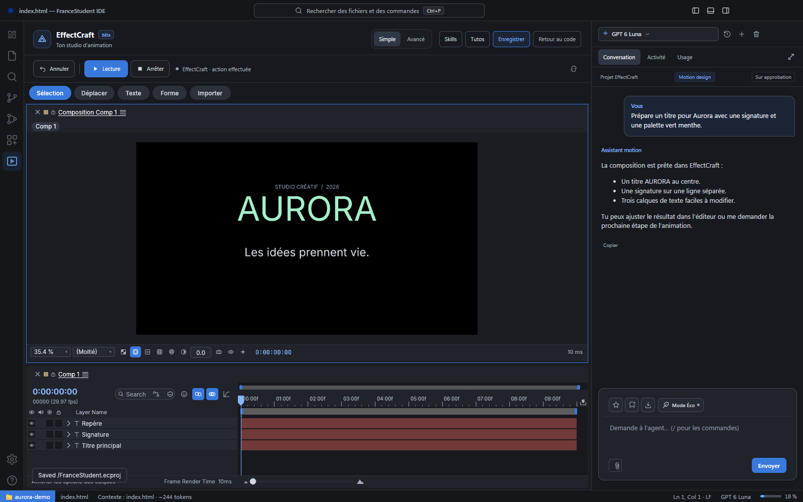



# FranceStudent IDE

**Du code aux animations, crée tes projets avec un assistant IA en français.**

[Télécharger pour Windows](https://github.com/extraopaa/francestudents-ide/releases/latest) · [Télécharger pour Mac — bêta](https://github.com/extraopaa/francestudents-ide/releases/tag/v1.3.3-mac.2) · [Guide d’utilisation](docs/guide-utilisation.md)

Un éditeur de code, un studio EffectCraft et un chat adapté à chaque espace.

## Le mode Code

Ouvre ton dossier, retrouve tes fichiers et explique ce que tu veux construire. L’assistant peut t’aider à comprendre le projet, modifier le code et lancer les vérifications. L’éditeur, le terminal et l’aperçu des sites restent à portée de main.

## Le mode Motion design · Bêta

Passe dans **EffectCraft** pour préparer tes compositions avec un chat spécialisé. Commence avec le mode **Simple**, suis les petits tutos et ouvre le mode **Avancé** pour retrouver les outils complets de l’éditeur.

Les conversations Code et Motion sont séparées : l’assistant motion travaille dans son propre espace.

## Installer l’application

| Ton ordinateur | Fichier à télécharger |
| --- | --- |
| **Windows 64 bits** | [Dernière version stable](https://github.com/extraopaa/francestudents-ide/releases/latest) → `setup.exe` |
| **Mac Apple Silicon** — M1 et suivants | [Bêta Mac](https://github.com/extraopaa/francestudents-ide/releases/tag/v1.3.3-mac.2) → `mac-arm64.dmg` |
| **Mac Intel** | [Bêta Mac](https://github.com/extraopaa/francestudents-ide/releases/tag/v1.3.3-mac.2) → `mac-x64.dmg` |

1. Sur Windows, ouvre l’installateur. Sur Mac, ouvre le DMG et déplace l’application dans **Applications**.
2. Lance FranceStudent IDE et suis le guide de connexion à ton **compte FranceStudent**.
3. Ouvre un dossier pour coder, ou passe dans le studio Motion pour commencer une composition.

Pas besoin d’installer Node.js ni de fournir une clé API pour utiliser le chat FranceStudent. Certains projets et outils peuvent demander leurs propres dépendances.

**Mises à jour :** Windows peut télécharger et installer les nouvelles versions automatiquement. À partir de la bêta Mac 2, l’IDE détecte les versions Mac et propose le bon installateur ; son installation reste manuelle. La version Mac est en bêta et n’est pas notariée par Apple. [Détails pour macOS](docs/macos.md).

## Ce que ce fork ajoute

- **Une interface harmonisée** : conversations récentes, réglages organisés et suivi du quota.
- **Des pièces jointes plus pratiques** : glisser-déposer, conversion de nombreux formats et envoi en lots quand le service l’exige.
- **Un mode Éco** et un avertissement avant les envois volumineux pour mieux maîtriser la consommation.
- **Des conversations qui se reprennent** : historique lisible, compaction du contexte et import de conversations Codex en bêta.
- **Des outils pour agir** : contrôle des serveurs locaux, annulation des actions et connecteur GitHub en bêta.
- **Une bibliothèque de skills** pour le code et une sélection dédiée au motion design, avec installation et désinstallation.
- **EffectCraft intégré** : chat motion spécialisé, mode Simple, outils avancés et tutos.

Les [notes de version](CHANGELOG.md) détaillent les ajouts et leurs limites.

## Les skills et le suivi d’usage

### Des outils pour tes animations

La sélection motion propose des skills pour les titres, logos, transitions, mouvements et exports. Les skills **EffectCraft** accompagnent le studio intégré ; les skills **Remotion** s’utilisent dans les projets de code. Le marketplace Code conserve **SkillsMP**.

### Ton quota, visible dans l’IDE

Clique sur la jauge pour ouvrir l’onglet **Usage** : budget disponible, compteurs de session et réinitialisation lorsque le service la communique. Le mode Éco réduit les capacités proposées pour limiter la consommation, sans garantir une économie précise.

Captures réalisées dans l’application sous Windows, avec le projet fictif Aurora. Les échanges et les chiffres d’usage sont des exemples de démonstration ; le code affiché et la composition EffectCraft sont réels.

## Garder le contrôle

Les réponses de l’IA et les pièces jointes consomment le quota de ton compte. Commence avec les confirmations activées et vérifie les modifications. Le mode **Full accès** autorise l’agent à agir sans confirmation : utilise-le avec des projets et outils auxquels tu fais confiance.

Télécharge les installateurs depuis les releases de ce fork. Windows et macOS peuvent afficher un avertissement pour une application sans signature d’éditeur reconnue.

## Pour aller plus loin

- [Guide d’utilisation](docs/guide-utilisation.md) : connexion, interface et premiers pas.
- [Guide avancé](docs/avance.md) : installation depuis les sources, réglages, formats et extensions.
- [Signaler un problème](https://github.com/extraopaa/francestudents-ide/issues) : indique ta version, ton système et les étapes pour reproduire le souci, sans identifiants.
- [Contribuer](CONTRIBUTING.md) · [Nouveautés](CHANGELOG.md) · [Crédits](CREDITS.md).

Pour reprendre le développement avec n’importe quel assistant IA, commence par [AGENTS.md](AGENTS.md) et [le contexte du projet](docs/AI_CONTEXT.md).

## Origine du projet

**FranceStudent IDE est un projet de [EsteG7](https://github.com/EsteG7/francestudents-ide).** Ce dépôt est un fork d’amélioration maintenu par [extraopaa](https://github.com/extraopaa), et non une version officielle du dépôt d’origine. Le crédit de la création revient à EsteG7 et aux contributeurs du projet original.
