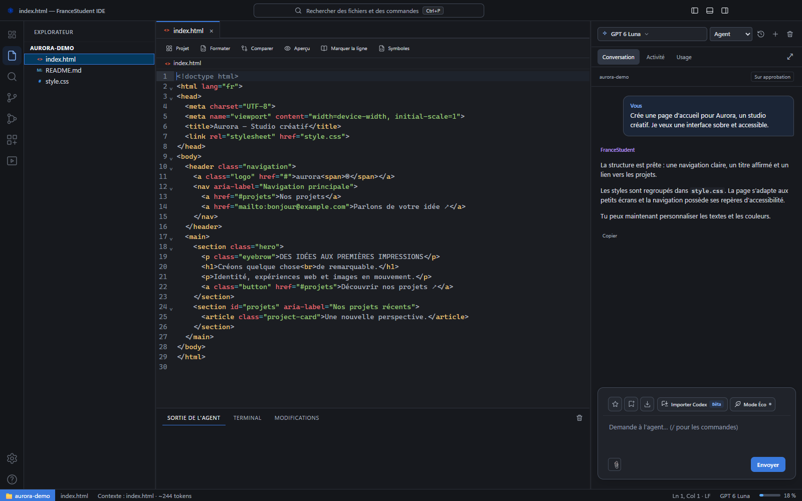

# Les guides FranceStudent IDE

[← Présentation et téléchargements](../README.md)

Choisis le parcours qui correspond à ton objectif. Les captures montrent l’application réelle avec un projet et des données de démonstration.

## Pour commencer

| Guide | Tu y trouveras… |
| --- | --- |
| [Installer l’application](installation.md) | Le bon fichier Windows ou Mac et les mises à jour |
| [Se connecter](connexion.md) | Le compte, le dossier et la première demande |
| [Premiers pas](guide-utilisation.md) | Les deux modes, le chat et les raccourcis |
| [Résoudre un problème](depannage.md) | Connexion, quota, images et serveurs |

## Pour tes projets

| Guide | Tu y trouveras… |
| --- | --- |
| [Code, cockpit et aperçu](studio.md) | L’éditeur, le terminal et les outils du projet |
| [Motion design](motion-design.md) | EffectCraft, tutos, outils et sauvegarde |
| [Documents et images](attachments.md) | Glisser-déposer, formats et limites |
| [Skills, marketplace et MCP](extensions.md) | Installer, activer et retirer des outils |
| [Usage et quota](usage.md) | La jauge, les compteurs et la réinitialisation |
| [Mode Éco](eco-mode.md) | Les possibilités et limites du mode |
| [Importer une conversation Codex](conversation-import.md) | Reprendre un échange |
| [Connecteur GitHub](github.md) | Dépôts, synchronisation et releases en bêta |
| [Serveurs locaux](server-controls.md) | Démarrer, arrêter et ouvrir un site |

## Pour aller plus loin

[Guide avancé](avance.md) · [macOS bêta](macos.md) · [Contribuer](../CONTRIBUTING.md) · [Architecture](architecture.md) · [Contexte pour les assistants IA](AI_CONTEXT.md).

Les documents [API](api.md), [SDK](sdkapi.md), [outils](tools.md), [CLI/TUI](tui.md) et [contexte](model-context.md) s’adressent aux développeurs.

Les captures sont réalisées sous Windows. Les comptes, échanges et chiffres présentés sont des exemples de démonstration. La version macOS reste en bêta.
