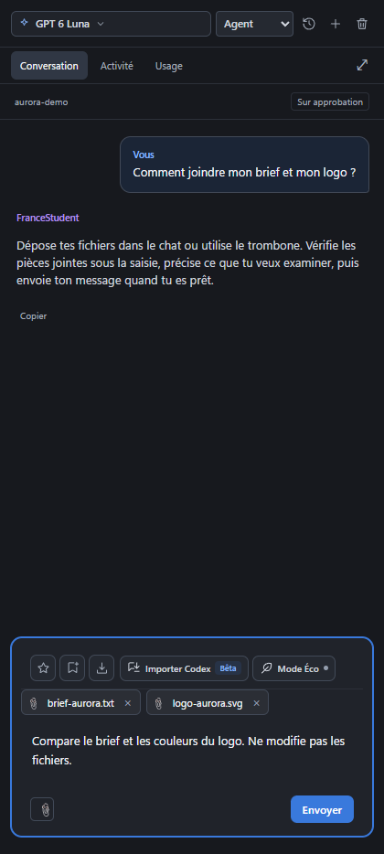

# Pièces jointes

[← Les guides](README.md) · [Usage et quota](usage.md)

## Joindre un fichier

Les images classiques strictement identiques d’un même envoi partagent une seule transmission et une seule entrée de vision, avec correspondance explicite de leurs positions. Toutes les images distinctes sont conservées. Cela n’ajoute aucune réduction de résolution ni compression destructive : les limites de préparation existantes restent identiques, et les originaux sont inchangés. Une image jointe à nouveau dans une demande suivante est retransmise explicitement, sans supposer que le fournisseur a gardé ses pixels.

### Préparation automatique

La préparation locale est utilisée automatiquement lorsqu’elle est disponible. En mode agent, les archives et gros documents sont indexés sur l’ordinateur et lus à la demande. Si cette préparation échoue ou que l’index est plein, l’IDE utilise la lecture classique ; les fichiers déjà sélectionnés dans un ZIP restent les seuls accessibles. Annuler la sélection n’ajoute pas l’archive. L’ancien réglage bêta n’est plus nécessaire.

Pour un ZIP, une fenêtre propose les fichiers contenus avant l’envoi : recherche, cases à cocher, Tout sélectionner ou Tout décocher. Rien n’est envoyé à l’IA pendant cet inventaire local. Seuls les éléments choisis sont accessibles à l’agent.

En mode agent, les archives et textes volumineux sont indexés sur l’ordinateur. L’IA reçoit l’inventaire, puis les passages ou images qu’elle demande ; elle peut poursuivre une lecture jusqu’à la fin sans transmettre tout le ZIP à chaque appel. Extraction, recherche et pagination n’utilisent pas de modèle IA. Le contenu demandé et son analyse par l’IA restent comptabilisés par le service.

L’index est en mémoire : il expire après deux heures sans utilisation ou au redémarrage. Sa limite de 128 Mo ne supprime pas les documents actifs : les pièces suivantes utilisent la lecture classique lorsqu’il n’y a plus de place. Un contenu expiré nécessite un nouvel envoi ; l’agent ne cherche jamais l’original sur le PC. Les limites de sécurité et de conversion restent applicables.

Les PDF sont consultés page par page en mode agent : texte extrait localement, puis rendu de la page uniquement si nécessaire. Une page scannée sans texte est envoyée à la vision du modèle ; l’extraction locale n’est pas présentée comme une analyse visuelle. Toutes les pages restent accessibles dans les limites de sécurité.

Pour les documents bureautiques contenant des médias, le texte et les images embarquées sont inventoriés séparément : l’agent peut lire le texte sans envoyer automatiquement toutes les images.

1. Ouvre une conversation et précise ce que l’IA doit examiner.
2. Clique sur le trombone ou glisse les fichiers dans le chat.
3. Vérifie les pièces jointes du brouillon et les éventuels avertissements.
4. Envoie ta demande quand tout est prêt.

Le nombre sélectionné n’est pas plafonné, mais les limites de taille, de contexte et de quota restent applicables. Pour un gros document, indique les pages ou feuilles utiles.



## Formats et traitement


Les fichiers sont préparés localement à l’envoi, sans service de conversion
externe. Leur nom et leur contenu original restent inchangés. La sélection,
le collage et le glisser-déposer utilisent le même circuit, y compris dans la
file d’attente. Déposer un fichier l’ajoute au brouillon sans envoyer le message.

| Famille | Informations transmises au modèle |
| --- | --- |
| PDF, scans inclus | En mode agent : texte extrait page par page, image pour une page scannée ou demandée visuellement ; repli classique par images si nécessaire |
| SVG | Source complète et rendu PNG sans scripts ni références externes |
| PNG, JPEG, WebP, BMP, TIFF, ICO, AVIF et images décodables par Sharp | Images adaptées aux limites de l’API ; TIFF multipages jusqu’à 40 pages |
| GIF et images animées | Première image, avec mention de la lecture partielle lorsque préparées comme document |
| DOCX, DOCM, DOTX, DOTM | Texte structuré, notes, images et données des graphiques extractibles |
| DOC, DOT historiques | Texte, en-têtes, notes et annotations extractibles |
| PPTX, PPTM, PPSX, PPSM, POTX, POTM | Texte dans l’ordre des diapositives, notes du présentateur, images et données des graphiques extractibles |
| PPT, PPS, POT historiques | Textes des enregistrements binaires ; lecture partielle, sans garantie d’ordre ni rendu |
| XLSX, XLS, XLSM, XLSB, XLT, XLTX, XLTM, ODS, OTS, FODS, Numbers et formats reconnus par SheetJS | Feuilles, adresses, valeurs enregistrées, formules disponibles, commentaires, liens et cellules fusionnées ; images embarquées et XML de graphiques des paquets ZIP |
| ODT, OTT, ODP, OTP, ODG, OTG, RTF | Texte, notes et images extractibles |
| EPUB | Chapitres dans l’ordre de lecture et images extractibles |
| EML, MSG | En-têtes utiles, corps et conversion récursive des pièces jointes |
| ZIP, TAR, GZIP/TGZ, 7z, RAR, XZ, BZIP2, Zstandard, LZMA, CAB, ISO, AR, DEB, RPM reconnus par 7-Zip | Inventaire local puis lecture des fichiers utiles en mode agent ; conversion récursive en repli classique, sans extraction sur le disque. Les ZIP respectent la sélection de l’utilisateur |
| Texte, code, CSV, TSV, JSON, XML, HTML, Markdown, ICS, VCF, sous-titres… | Contenu textuel ; UTF-8, UTF-16 avec BOM et Windows-1252 pour les fichiers texte reconnus |
| Audio et vidéo reconnus par MediaInfo | Métadonnées et informations sur les pistes ; lecture partielle, sans transcription du son ni analyse des images vidéo |
| Autres binaires, fichiers endommagés ou protégés | Rapport explicitement partiel : motif, taille, type, SHA-256, signature et échantillon de chaînes lisibles |

Un type inconnu ou un décodeur en échec n’empêche plus la transmission des autres
fichiers : le modèle reçoit un rapport qui indique exactement ce qui a été lu.
Ce repli n’équivaut pas à comprendre intégralement n’importe quel format. Les
fichiers chiffrés ne sont pas déchiffrés sans mot de passe, et une présentation ou
un classeur extrait en texte ne constitue pas un rendu fidèle de sa mise en page.
Les macros ne sont pas exécutées, les formules ne sont pas recalculées et les
liens externes ne sont pas suivis.

Le nombre de fichiers sélectionnés n’est pas plafonné. Au-delà de quatre images
ou anciens fichiers Files v2, des messages successifs transmettent les lots dans
la même conversation, puis la demande finale produit la seule réponse visible.
Les textes longs sont également répartis en lots. Les lots confirmés sont
réutilisés lors d’une relance ; une nouvelle conversation reçoit tous les lots.

Les limites de ressources restent applicables : 25 Mo par fichier en entrée,
2 millions de caractères par document converti, 40 pages PDF/TIFF, 50 Mo d’images
PDF, 200 000 cellules par classeur, 100 Mo décompressés et trois niveaux de
récursion par fichier principal. Les archives sont inspectées sans monter le
système de fichiers réel ; liens, chemins sortants et entrées spéciales ne sont
pas suivis. Une limite atteinte est signalée dans le rapport partiel.
La file conserve ses limites de stockage : 50 Mo par demande et 200 Mo au total.
Le découpage ne rend pas le contexte du modèle illimité.

Outils open source : [PDF.js](https://mozilla.github.io/pdf.js/),
[Sharp](https://sharp.pixelplumbing.com/),
[OfficeParser](https://github.com/harshankur/officeParser),
[SheetJS CE](https://docs.sheetjs.com/docs/getting-started/installation/nodejs/),
Word Extractor, MailParser, MSG Reader, yauzl, tar-stream, 7-Zip WASM et MediaInfo.
Aucune application Office ou LibreOffice n’est requise.

Vérifications :

```sh
node --test test/document-conversion.test.js test/file-conversion.test.js test/api-files.test.js test/pdf-text.test.js test/attachment-batches.test.js
node --test e2e/attachment-drop.e2e.test.js e2e/queue-attachments.e2e.test.js
```

### Archives ZIP jointes au chat

Le contenu est ouvert localement puis transmis à l’IA sous forme de texte et d’images, avec les chemins internes à l’archive. Une entrée trop lourde, chiffrée ou illisible est signalée ; les autres fichiers lisibles restent disponibles. Pour certaines compressions ZIP particulières, un second lecteur local 7-Zip est utilisé. Si la lecture reste partielle, un avertissement apparaît et l’IA reçoit les limites précises. L’archive ne doit pas être recherchée ailleurs sur le PC et n’est pas extraite automatiquement dans le projet.
