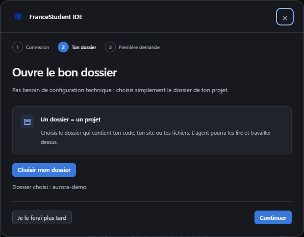
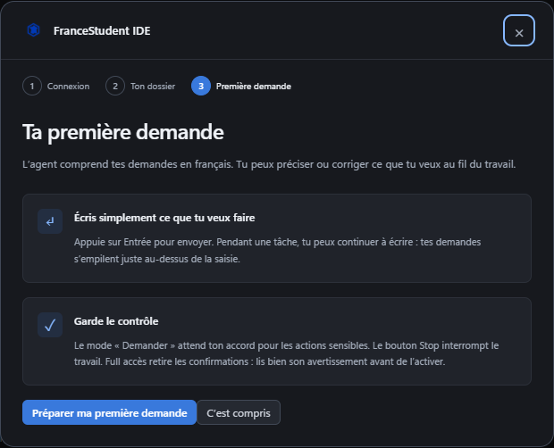

# Se connecter et faire sa première demande

[← Les guides](README.md) · [Installation](installation.md) · [Premiers pas](guide-utilisation.md)

Le guide s’ouvre lorsqu’une connexion est nécessaire. Retrouve-le avec **?** ou dans **Paramètres → Connexion et prise en main**.

## 1. Ton compte FranceStudent

Utilise les mêmes identifiants que sur le site : adresse e-mail et mot de passe. Clique sur le bouton de connexion. Aucune clé API n’est nécessaire.

Le mot de passe n’est pas conservé par l’application ni ajouté à la conversation. Seule la session est enregistrée localement. Le formulaire ne prend pas en charge une étape supplémentaire de captcha ou de double authentification.

En cas d’erreur, vérifie tes identifiants et Internet. Le champ mot de passe est vidé après la tentative : saisis-le à nouveau. Ne colle jamais ton mot de passe dans le chat.

## 2. Le dossier de ton projet

Choisis le dossier qui contient ton site ou ton application. Pour continuer un travail existant, sélectionne son dossier actuel. Tu peux passer cette étape pour une question générale.

Le dossier Code et l’espace Motion sont distincts. Pour une composition, tu pourras ensuite ouvrir **Motion design**.

## 3. Une première demande

**Préparer ma première demande** place un exemple dans la saisie. Relis-le et adapte-le, puis envoie-le quand tu es prêt.

Par exemple : « Explore ce projet, explique comment le lancer et propose une petite amélioration ». Préparer le brouillon n’envoie pas de message à l’IA.

## Se déconnecter ou changer de compte

Arrête la tâche en cours, puis ouvre **Paramètres → Connexion et prise en main → Se déconnecter**. Les fichiers et conversations sont conservés ; les demandes en attente sont mises en pause. La connexion du navigateur reste indépendante.

La commande `/logout` effectue la même déconnexion. Pour une erreur persistante, consulte le [dépannage](depannage.md#connexion).
