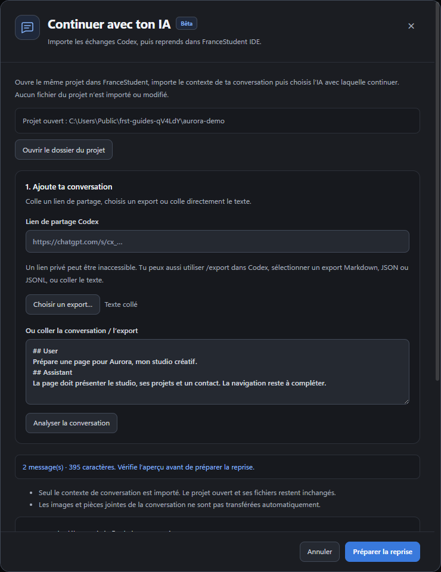

# Continuer une conversation Codex (bêta)

[← Les guides](README.md) · [Premiers pas](guide-utilisation.md)

## Reprendre en quatre étapes

1. Ouvre le dossier de ton projet existant.
2. Clique sur **Importer Codex · Bêta**.
3. Ajoute le lien, le texte ou un export et analyse l’aperçu.
4. Prépare la reprise, puis relis ton brouillon avant de l’envoyer.

## Fonctionnement et limites

Ouvre le dossier de ton projet existant dans FranceStudent IDE, puis clique sur **Importer Codex · Bêta**, près du bouton d’export de conversation.

Colle un lien de partage accessible (notamment `https://chatgpt.com/s/cx_…`), sélectionne un export Markdown, JSON ou JSONL, ou colle directement la conversation. Vérifie l’aperçu, choisis le modèle et le mode, puis clique sur **Préparer la reprise**. Le contexte complet devient une pièce jointe du brouillon ; tu peux modifier ta demande avant de cliquer sur **Envoyer**.

Les liens Codex `/s/cx_…` sont lus via l’instantané public utilisé par la page de partage, dont les messages sont chargés séparément du HTML. Les messages utilisateur et les réponses/commentaires de l’agent sont repris dans l’ordre. Les différences de fichiers et les résumés internes ne sont pas importés.

L’import concerne uniquement la conversation : aucun fichier de projet n’est copié ou modifié. Les commandes et résultats de l’ancien historique ne prouvent pas l’état du projet ouvert. Les images et pièces jointes d’origine doivent être ajoutées séparément si elles sont nécessaires.

Les liens privés ou réservés à un espace de travail peuvent être inaccessibles : l’importeur n’utilise ni cookies ni identifiants ChatGPT. Utilise alors un export de cette conversation. Codex propose `/export` pour enregistrer un fichier Markdown. Les pages partagées évoluant, leur lecture reste expérimentale ; un export est le repli recommandé.

Limites de cette bêta : 8 Mo par source, 5 000 messages et 1,5 million de caractères. Les 80 derniers messages sont affichés dans la conversation ; l’historique importé complet est joint au brouillon. L’aperçu expire après 30 minutes. Les exports JSON avec plusieurs conversations doivent être séparés avant import. Seuls les messages utilisateur et assistant sont repris depuis les exports structurés.

Références officielles : [partager un instantané Codex](https://learn.chatgpt.com/docs/use-chatgpt#share-a-read-only-snapshot-of-a-codex-thread), [commande /export](https://learn.chatgpt.com/docs/developer-commands).
