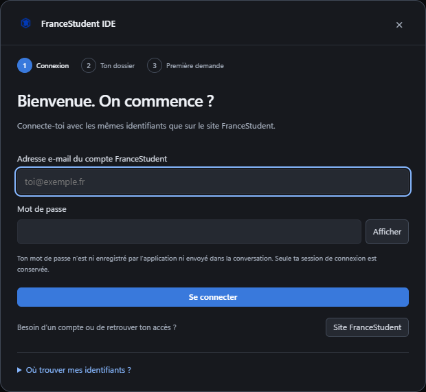

# Résoudre un problème

[← Les guides](README.md) · [Signaler un problème](https://github.com/extraopaa/francestudents-ide/issues)

Commence par noter la version de l’application, ton système et les étapes qui reproduisent le souci. Ne partage jamais de mot de passe, token ou conversation privée dans une issue publique.

## Connexion

Vérifie Internet et les identifiants du compte FranceStudent. Saisis à nouveau le mot de passe, vidé après une tentative. Le formulaire ne gère pas les étapes supplémentaires de captcha ou de double authentification.

Rouvre le guide avec **?** ou **Paramètres → Connexion et prise en main**. [Voir les étapes illustrées](connexion.md).

## Quota et erreurs API

L’onglet [Usage](usage.md) distingue le budget du compte et les compteurs de session. Si le quota est épuisé, consulte l’échéance communiquée. **J’ai reçu un reset** vérifie un reset accordé ; il n’en crée pas.

Une indisponibilité temporaire du service peut demander de réessayer plus tard. Une conversation verrouillée par le fournisseur nécessite d’ouvrir une nouvelle conversation. L’IDE ne connaît pas forcément le motif précis de ce verrouillage.

## Contexte trop long

Une erreur « maximum token limit » doit déclencher une tentative de compaction et de reprise bornée. Si l’erreur persiste, conserve l’historique, ouvre une nouvelle conversation et joins un résumé du travail. Une limite de contexte et un quota épuisé sont deux situations différentes.

## Images et documents

Vérifie que la pièce jointe est bien présente avant l’envoi. Une conversion partielle ou une réduction importante peut empêcher de lire de petits détails. Recadre l’élément utile et joins-le à nouveau si nécessaire. [Formats et limites](attachments.md).

## Le site ne s’ouvre pas

Le serveur doit être lancé et son port disponible. Consulte sa sortie, vérifie l’adresse et actualise l’aperçu. **Arrêter** ne coupe que le processus lancé par les contrôles de l’IDE. [Guide des serveurs locaux](server-controls.md).

## Le studio Motion ne répond pas comme prévu

Vérifie que tu es dans le bon espace, termine la tâche et enregistre le projet avant de redémarrer. Le mode Avancé retrouve les outils complets d’EffectCraft. Les formats et opérations d’export restent soumis aux capacités du moteur. [Guide Motion](motion-design.md).

## Installation et mise à jour Mac

Choisis le DMG correspondant à ta puce. La version est en bêta et n’est pas notariée par Apple. À partir de la bêta 2, la détection des versions est intégrée mais l’installation reste manuelle. [Guide Mac](macos.md).
