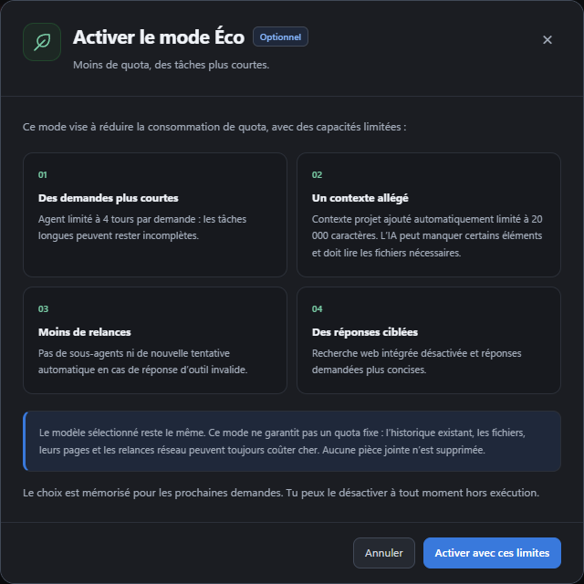

# Mode Éco

[← Les guides](README.md) · [Usage et quota](usage.md)

Pour une petite demande, active **Mode Éco** près de la saisie et lis les limites avant de confirmer. Tu peux annuler sans changer de mode.

Le bouton **Mode Éco**, dans les outils de la saisie, affiche les limites avant activation. Annuler conserve le mode normal. Le choix confirmé est mémorisé dans les paramètres utilisateur ; un nouveau clic désactive le mode hors exécution.

L’agent dispose de quatre tours par demande, sans sous-agents ni reprise du protocole après une réponse d’outil invalide. Lorsqu’il atteint la limite, il indique que le travail peut être incomplet et conserve les modifications déjà effectuées. Chaque tour peut contenir un lot d’outils. Les relances réseau et la compaction peuvent engendrer d’autres appels : quatre tours ne signifie pas quatre requêtes HTTP maximum.

Le contexte projet fourni automatiquement est limité à 20 000 caractères ; les fichiers nécessaires peuvent encore être lus explicitement. Les instructions du projet, les permissions et les fichiers joints restent conservés. La recherche web intégrée est désactivée et les instructions n’encouragent plus les recherches spontanées. Une recherche explicitement demandée reste possible avec les outils locaux.

Les réponses sont demandées concises, sans plafond de sortie garanti par l’API. Le modèle n’est pas changé et l’historique existant n’est pas effacé. Aucune réduction chiffrée ni consommation maximale n’est garantie : les pièces jointes, les pages converties, l’historique, les relances et les tarifs du modèle peuvent toujours consommer un quota élevé. Le mode normal conserve son fonctionnement habituel.
