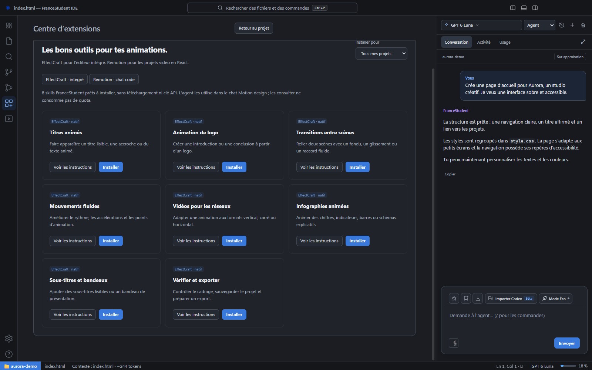

# Skills, marketplace et serveurs MCP

[← Les guides](README.md) · [Motion](motion-design.md) · [Guide avancé](avance.md#permissions-et-extensions)

Un **skill** apporte des instructions spécialisées. Un **serveur MCP** connecte des outils et peut lancer un programme local. Les installer ne leur donne pas automatiquement les mêmes capacités.

## Installer et retirer un skill

1. Ouvre **Extensions** dans la barre de gauche.
2. Parcours la bibliothèque ou la marketplace et lis les instructions.
3. Choisis la portée : tous tes projets ou le projet courant.
4. Clique sur **Installer**, puis vérifie son activation dans **Mes skills**.

Le bouton devient **Désinstaller** pour un skill installé. La désinstallation conserve son dossier dans `.trash`. Désactiver un skill permet de garder ses fichiers sans utiliser ses instructions.

## Choisir la bonne collection

| Collection | Utilisation |
| --- | --- |
| Bibliothèque | Skills embarqués, sans recherche externe |
| Marketplace code — SkillsMP | Instructions communautaires pour les projets Code |
| Motion — EffectCraft | Méthodes pour le studio intégré |
| Motion — Remotion | Vidéos React dans l’espace Code |

Les imports communautaires SkillsMP sont installés désactivés et ne copient que le SKILL.md. Leurs scripts et dépendances ne sont pas installés. Les bundles Remotion peuvent inclure leurs références : lis les instructions et la licence avant activation.

Les profils mémorisent un ensemble de skills actifs. Appliquer un profil peut désactiver les autres skills du catalogue courant.

## Connecter un serveur MCP

Dans **Extensions → Serveurs MCP**, renseigne la commande, les arguments et les variables demandés par l’outil. Ajouter ou réactiver la connexion peut lancer son programme local.

Vérifie la provenance du serveur avant de l’activer. **Retirer la connexion** supprime sa configuration de l’IDE avec sauvegarde ; cela ne désinstalle pas le programme de l’ordinateur. Les variables sont stockées localement : n’y mets que les accès nécessaires.

Les serveurs et leurs dépendances doivent être compatibles avec ton système. Un outil conçu uniquement pour Windows n’acquiert pas une version Mac parce qu’il est ajouté à l’IDE.
