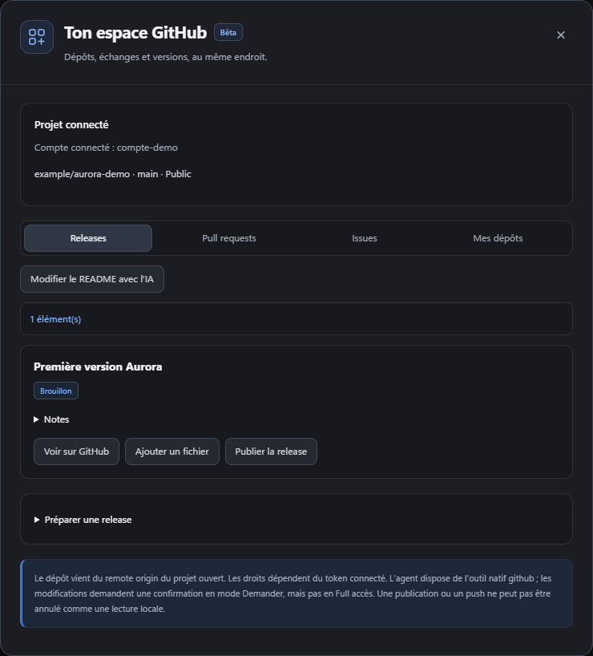

# Connexion à GitHub · connecteur Bêta

[← Les guides](README.md) · [Guide avancé](avance.md)

## Le connecteur en un coup d’œil

Connecte ton compte dans le panneau Git, vérifie le dépôt associé, puis ouvre le connecteur. Prépare et relis un brouillon avant toute publication. La capture utilise un compte fictif et ne publie rien sur GitHub.

## Utiliser le connecteur

Dans le panneau **Git**, clique sur **Connecteur GitHub · Bêta** après avoir connecté ton compte. Il utilise le dépôt `origin` du projet ouvert. Tu peux consulter les releases, PR, issues et dépôts, préparer un brouillon de release, y ajouter un fichier du projet puis choisir **Publier la release**.

L’agent dispose aussi d’un outil natif `github` : lecture de fichiers, mise à jour distante avec branche et SHA explicites, commit de fichiers choisis, push/pull/fetch, création d’issues et de PR. Pour modifier un README du projet, préfère une modification locale suivie d’un commit et d’un push. Une modification distante ne change pas la copie locale : récupère ensuite les changements.

Les releases sont créées en brouillon ; leur publication est une action séparée. L’envoi de fichiers se fait uniquement sur un brouillon. L’outil ne propose ni push forcé ni suppression de dépôt. En mode avec approbation, les écritures demandent confirmation ; en Full accès, elles suivent les instructions de l’utilisateur sans question supplémentaire. L’annulation n’efface pas une opération déjà terminée sur GitHub.

Un token finement limité doit autoriser **Contents** en écriture pour les fichiers et releases, **Pull requests** pour les PR et **Issues** pour les issues. Les droits effectifs du compte et du dépôt s’appliquent toujours. Le token local est enregistré dans un fichier, sans chiffrement applicatif ; il n’est pas envoyé au modèle.

La commande `/github` connecte la CLI et l'application de bureau à un compte GitHub. Elle permet ensuite de configurer le remote du projet et de faire `push`, `pull` et `fetch` authentifiés.

## Se connecter

- `/github login` : si `FS_GITHUB_CLIENT_ID` est défini (OAuth App avec Device Flow activé), affiche une adresse et un code à saisir dans le navigateur. Sinon, demande un token personnel.
- `/github token` : demande un token personnel, saisi de façon masquée. Créer le token sur https://github.com/settings/tokens :
  - token classique : scope `repo` ;
  - token fine-grained : permission Contents en lecture et écriture sur les dépôts voulus.
- Le token est vérifié avec `GET https://api.github.com/user`, puis enregistré dans `~/.francestudent-cli/github.json` (mode 0600, ou dans `FS_DATA_DIR`).
- Sans token enregistré, les variables `GITHUB_TOKEN` ou `GH_TOKEN` sont utilisées.
- `/github status` : compte connecté, token masqué, scopes et remote `origin`.
- `/github logout` : efface le token local. Ne révoque pas le token chez GitHub.

## Dépôt et synchronisation

| Commande | Effet |
| --- | --- |
| `/github remote` | Affiche le remote `origin` |
| `/github remote owner/repo` | Ajoute ou met à jour `origin` (`https://github.com/owner/repo.git`) |
| `/github create <nom> [public]` | Crée un dépôt (privé par défaut) et le définit comme `origin` |
| `/github push [branche]` | `git push -u origin <branche courante>` |
| `/github pull [branche]` | `git pull --ff-only origin <branche>` |
| `/github fetch` | `git fetch --prune origin` |

## Panneau Git de l'application de bureau

Le panneau Git de l'application de bureau propose les mêmes actions sans passer par la commande `/github` :

- Boutons de l'en-tête :
  - **Pull** : `git pull --ff-only origin <branche courante>` ;
  - **Fetch** : `git fetch --prune origin` ;
  - **Push** : `git push -u origin <branche courante>` ;
  - **Actualiser** : met à jour le statut.
- Zone de commit : saisir un message, puis cliquer sur **Valider tout** ou appuyer sur Ctrl/Cmd+Entrée. Le panneau lance `git add -A`, puis `git commit -m`. S'il n'y a aucune modification, il affiche « Rien à valider ».
- Section **GitHub** :
  - affiche le compte connecté, le token masqué et le remote `origin` ;
  - **Connecter** : enregistre un token personnel saisi dans un champ masqué. Le champ est vidé après la tentative ;
  - **Déconnecter** : efface le token local ;
  - **Définir le remote** : accepte `owner/repo` ou une URL GitHub ;
  - **Créer le dépôt** : crée un dépôt privé par défaut, ou public si la case est cochée. Si le projet n'a pas encore de remote `origin`, le dépôt créé devient `origin`.
- Les boutons sont désactivés pendant une action. Le résultat ou l'erreur s'affiche sous laligne de la branche, puis le statut est actualisé.
- Le token n'est jamais envoyé à l'interface : seul le processus principal Electron y a accès, et les messages d'erreur sont filtrés par `redact()`.

Code : `desktop/git.js` (commit), handlers IPC `github*` et `gitCommit` dans `desktop/main.js`, `desktop/preload.js`, `desktop/renderer/src/16-git.js`.

## Sécurité

- Le token ne passe jamais dans les arguments de `git`, ni dans l'URL du remote, ni dans `.git/config`. Il est transmis par l'environnement (`GIT_CONFIG_COUNT`/`GIT_CONFIG_KEY_0`/`GIT_CONFIG_VALUE_0`) sous forme d'en-tête HTTP `http.https://github.com/.extraheader`, uniquement pour les remotes HTTPS de github.com.
- Les sorties et les erreurs sont filtrées pour ne jamais afficher le token.
- `GIT_TERMINAL_PROMPT=0` : git ne bloque jamais en attendant un mot de passe.
- Les remotes SSH (`git@github.com:…`) utilisent la clé SSH de la machine, sans le token.

Code : `src/github.js`. Tests : `test/github.test.js` (fetch et git simulés).
