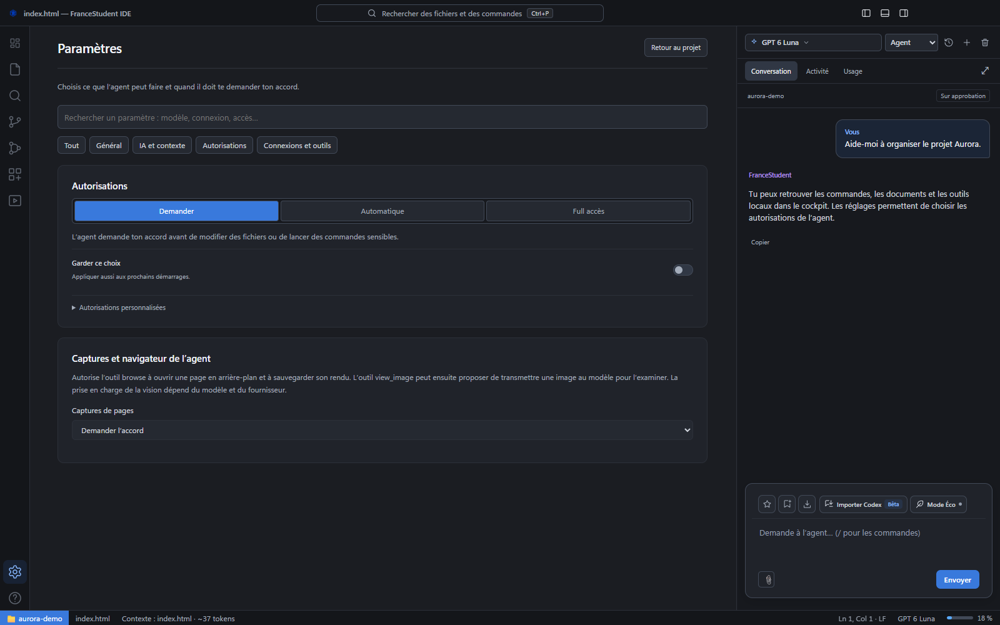

# Bien commencer avec FranceStudent IDE

[← Les guides](README.md) · [Connexion](connexion.md) · [Guide avancé](avance.md)

Un dossier, une idée et une conversation : voici comment démarrer. Les captures utilisent le projet fictif **Aurora**, sans compte personnel.

## 1. Installer et se connecter

Télécharge l’installateur adapté depuis le [guide d’installation](installation.md). L’application installée ne demande ni Node.js ni npm.

Utilise l’adresse e-mail et le mot de passe de ton compte FranceStudent. Aucune clé API n’est nécessaire. [Voir les trois étapes de connexion](connexion.md).

## 2. Choisir ton espace

| Tu veux… | Ouvre… | Exemple de demande |
| --- | --- | --- |
| Créer un site ou modifier une application | **Code**, avec le dossier du projet | « Présente ce projet et propose une première amélioration. » |
| Préparer une composition ou une animation | **Motion design** | « Prépare un titre pour mon association avec une signature. » |

Les conversations et brouillons Code et Motion sont séparés. L’assistant motion travaille dans son propre espace EffectCraft.

## 3. Faire une demande en mode Code

1. Clique sur **Ouvrir un dossier** et choisis ton projet.
2. Clique sur un fichier pour l’ouvrir dans l’éditeur.
3. Explique ton objectif dans le chat, puis appuie sur **Entrée**.
4. Lis les changements et les éventuelles confirmations. **Stop** interrompt la tâche.

Une consigne précise aide : « Ajoute une navigation accessible et conserve les couleurs actuelles ». **Maj+Entrée** ajoute une ligne sans envoyer le message.

Pendant le travail, les nouvelles demandes s’empilent au-dessus de la saisie. **Orienter** transmet une consigne à la tâche en cours ; **Reprendre** relance une file suspendue. Les pièces jointes restent associées à leur demande.

## 4. Essayer le mode Motion

Ouvre **Motion design**, garde **Simple** et décris ta composition. **Tutos** prépare des exemples, **Skills** ouvre les méthodes disponibles et **Avancé** affiche les outils complets.

**Enregistrer** garde le projet modifiable dans le stockage local du moteur. Pour les travaux importants, conserve aussi une copie du projet et de ses médias. [Parcours Motion](motion-design.md).

## 5. Ajouter les bons éléments

- [Documents et images](attachments.md) : trombone ou glisser-déposer, sans envoi automatique.
- [Conversations Codex](conversation-import.md) : reprendre un échange dans un projet existant.
- [Skills et MCP](extensions.md) : ajouter et gérer des outils spécialisés.
- [Serveurs locaux](server-controls.md) : démarrer, arrêter et ouvrir un site.

## 6. Suivre le travail et le quota

**Conversation** affiche les échanges, **Activité** les actions et **Usage** la consommation. Clique sur la jauge pour ouvrir le détail. [Comprendre les compteurs](usage.md).

Les conversations récentes permettent de reprendre un échange. Une nouvelle conversation vide le chat affiché sans supprimer les précédentes. La compaction allège le contexte de l’IA en conservant le journal visible.

## 7. Garder le contrôle

Commence avec **Demander**, qui conserve les confirmations. **Full accès** autorise l’agent à agir sans question supplémentaire, avec les droits de ton compte, y compris hors du projet selon les outils. Il n’accorde pas de droits administrateur.

**Annuler l’action** tente d’interrompre l’opération courante ; **Stop** arrête toute la tâche. Les commandes et effets distants déjà terminés ne sont pas toujours annulables.

## Les raccourcis utiles

Sur Mac, utilise **Cmd** à la place de **Ctrl** pour les raccourcis correspondants.

| Raccourci | Action |
| --- | --- |
| Ctrl+O | Ouvrir un dossier |
| Ctrl+P | Aller à un fichier |
| Ctrl+Maj+P | Palette de commandes |
| Ctrl+S | Enregistrer |
| Ctrl+L | Aller à la saisie |
| Ctrl+B | Afficher ou masquer la barre latérale |
| Ctrl+J | Afficher ou masquer le panneau du bas |

Un problème ? Consulte le [dépannage](depannage.md). Pour le terminal, les réglages techniques et la compilation, ouvre le [guide avancé](avance.md).
