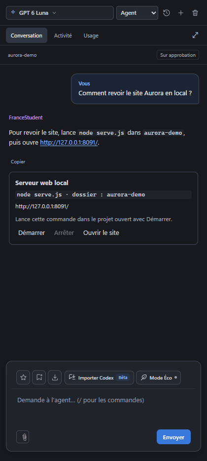

# Contrôles de serveur dans les réponses

[← Les guides](README.md) · [Code et cockpit](studio.md)

## Démarrer, arrêter, ouvrir

Les boutons restent dans la réponse de l’assistant. Vérifie la commande et le dossier, clique sur **Démarrer**, puis sur **Ouvrir le site**. **Arrêter** coupe le serveur lancé par cette carte.

## Ce que font les contrôles

Une réponse de l’IA qui contient une commande de serveur dans un bloc de code ou entre accents graves, et une adresse HTTP locale, peut afficher **Démarrer**, **Arrêter** et **Ouvrir le site**. Par exemple : « lancez `node serve.js` dans `f1-vision-site`, puis ouvrez http://127.0.0.1:8091/ ».

Le dossier est résolu à l’intérieur du projet ouvert ; si le projet est déjà le dossier nommé, la commande est lancée à sa racine. La commande et le dossier sont affichés avant lancement. Rien ne démarre automatiquement. Les commandes reconnues sont un script Node, les scripts dev/start/serve/preview de npm/pnpm/yarn et `python -m http.server`.

Le processus utilise le gestionnaire des Exécutions : sortie et erreurs sont consultables dans la carte, et le serveur apparaît également dans le cockpit. Les cartes d’une même commande suivent son état. Arrêter termine uniquement le processus lancé depuis ces contrôles et ses descendants ; un serveur lancé ailleurs reste géré depuis son terminal ou son outil d’origine. Un serveur déjà présent sur le port peut empêcher le lancement : consulte alors la sortie.

Ouvrir le site affiche l’adresse dans le navigateur intégré. « Processus en cours » ne garantit pas que le site est déjà prêt ; utilise l’actualisation du navigateur si nécessaire. Les messages ambigus avec plusieurs commandes ou adresses locales distinctes conservent leur texte sans lancement proposé. Les fichiers manquants et les changements de projet sont signalés au clic sur Démarrer.
