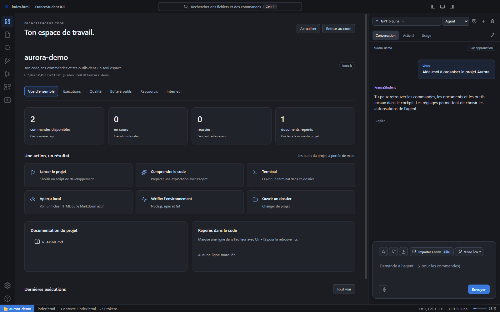

# Le cockpit et les outils de FranceStudent Code

[← Les guides](README.md) · [Premiers pas](guide-utilisation.md) · [Motion design](motion-design.md)

Le cockpit regroupe les commandes et outils du dossier ouvert. Tu peux revenir à l’éditeur sans fermer ton projet.

Le bouton **Cockpit du projet** ouvre une vue centrale qui conserve le chat à droite. `Ctrl+Maj+D` y donne accès. Le thème sombre d’origine reste sélectionné par défaut.

## Exécuter et vérifier

La vue **Exécutions** détecte les scripts de `package.json` et les commandes courantes de Rust et Go. Le gestionnaire Node est choisi d’après `packageManager` et les fichiers de verrouillage. Rien n’est exécuté lors de la détection.

Un clic lance une commande dans le dossier du projet. La sortie, le code de retour, l’état et la durée sont consultables pendant cette session. Quatre commandes peuvent tourner simultanément. **Arrêter** termine le groupe de processus ; **Relancer** réexécute la définition actuelle. Les commandes personnelles sont enregistrées dans `.frst/ide-tasks.json`. Leur retrait conserve une copie dans `.frst/ide-tasks.json.backup`.

**Qualité** vérifie la disponibilité de Node.js, npm et Git et regroupe les diagnostics JS/TS des fichiers ouverts. Cela ne remplace pas les tests et le lint du projet, accessibles dans Exécutions. Les actions de revue, de tests et de sécurité préparent une demande dans la saisie de l’agent ; elles ne l’envoient pas automatiquement.

## Édition et navigation

- Prettier formate JS/TS, JSON, CSS/SCSS/Less, HTML/Vue, Markdown et YAML sans exécuter la configuration ou les plugins du projet.
- **Comparer** ouvre deux panneaux CodeMirror Merge en lecture seule : la version enregistrée ou Git HEAD à gauche, le document actuel à droite.
- **Symboles**, ou `Ctrl+Maj+O`, utilise le serveur TypeScript pour les symboles JS/TS et repère les titres Markdown.
- `Ctrl+F2` ajoute ou retire un repère de ligne. Les repères sont locaux à ce projet et restent accessibles dans le cockpit.
- `Ctrl+Maj+S` enregistre tous les onglets modifiés.
- La palette utilise Fuse.js pour retrouver les fichiers et les commandes, y compris avec de petites erreurs de saisie.
- Les réglages de police, indentation, retour à la ligne, enregistrement automatique, formatage à l’enregistrement et réduction des animations sont dans **Paramètres → Éditeur et apparence**. L’enregistrement automatique attend deux secondes sans saisie. Le thème **Minuit** est facultatif.

Le texte UTF-8, UTF-8 avec BOM et UTF-16 LE/BE avec BOM est reconnu. Le BOM, l’encodage et les fins de ligne sont conservés à l’enregistrement. Les images courantes et les petits médias ont un aperçu en lecture seule. Les documents Office, PDF, archives, formats binaires et fichiers trop volumineux ont une fiche et un aperçu borné ; ils ne sont pas réécrits comme du texte. Leur modification spécialisée passe par l’application associée. Les formats exécutables ne sont pas lancés depuis ce bouton.

## Aperçus

**Aperçu**, ou `Ctrl+Maj+V`, affiche le Markdown actif à côté du code. Marked interprète le Markdown et DOMPurify retire les éléments dangereux. Les images distantes et scripts ne sont pas exécutés dans ce rendu.

Un fichier HTML enregistré peut être servi localement par l’application. L’aperçu s’ouvre dans une iframe isolée, sans accès au pont natif de l’IDE. Le serveur est limité à la boucle locale, utilise une adresse avec jeton, refuse les secrets et liens symboliques et ne sert pas les dossiers cachés. Les ressources relatives sont prises en charge. Les chemins absolus depuis la racine du site et les fonctions nécessitant cookies ou stockage peuvent demander le vrai serveur de développement.

Pour Vite ou un autre serveur, lance d’abord son script puis clique sur son lien `http://localhost:PORT` dans le chat ou le terminal. Tu peux aussi saisir l’adresse dans l’aperçu existant. Le site s’ouvre dans un onglet de navigateur local, avec une barre compacte inspirée du Simple Browser de VS Code : précédent, suivant, actualiser, adresse, ouverture dans le navigateur système et outils de développement.

Cet onglet utilise une vue Chromium indépendante de l’iframe documentaire. Le stockage local, les cookies, les appels API et les WebSockets suivent les règles normales du navigateur ; les en-têtes interdisant l’intégration dans une iframe ne bloquent plus cette vue. La page n’a pas accès au pont natif de l’IDE ni à Node.js. Les permissions sensibles, téléchargements et navigations hors de localhost ou 127.0.0.1 sont bloqués dans cet onglet. Pour une connexion qui redirige vers un fournisseur externe, utilise le navigateur système. Un serveur arrêté produit un message et un bouton Réessayer.

`Ctrl+L` cible l’adresse quand cet onglet est actif ; `Ctrl+W` le ferme. Les onglets de fichiers restent accessibles et conservent leur contenu. L’aperçu du navigateur ne constitue pas un contrôle automatique de tout le site.

## Internet, captures et modèle

La vue **Internet** lance des recherches en arrière-plan. L’agent dispose du même mécanisme avec `web_search` et `background:true`, puis `web_search_result`. Il peut poursuivre une autre étape pendant la recherche. Les sources sont distinguées des pages effectivement lues ; `web_fetch` reste nécessaire pour vérifier leur contenu.

`browse` utilise Chrome, Edge ou Chromium déjà installé, sans fenêtre visible. Il enregistre un PNG dans `.frst/screenshots` et relève le texte et les erreurs de console. `FS_BROWSER_PATH` peut désigner un navigateur compatible. **Paramètres → Captures et navigateur de l’agent** permet de demander l’accord, autoriser ou désactiver les captures. Full accès retire les confirmations ordinaires mais ne réactive pas une capture explicitement désactivée.

`view_image` permet de joindre une image du projet à la prochaine requête du modèle, après l’accord prévu par les permissions. La vision dépend du modèle et de l’API FranceStudent : le logiciel ne prétend pas avoir examiné visuellement un rendu si l’image n’a pas été analysée. Les images et pages restent des données non fiables, distinctes des instructions du projet.

Les images sont préparées avant leur téléversement : PNG, JPEG, WebP ou GIF, au maximum 25 Mo et 100 millions de pixels à l’entrée du moteur. La copie envoyée est redimensionnée sans recadrage à 6000 pixels maximum par côté et compressée si nécessaire pour rester sous 5 Mo. L’original reste intact. Une capture très longue peut perdre en lisibilité après réduction. Les images animées nécessitant une transformation sont envoyées sous forme d’une image fixe. Les erreurs de requête définitives ne sont pas relancées en boucle ; une ancienne image hors limites dans l’historique déclenche une tentative de reprise avec le contexte textuel dans une nouvelle conversation.

Pour les pièces jointes du chat, une forte réduction ou compression affiche un indicateur de lisibilité et les dimensions avant/après. Avant l’envoi, une confirmation propose de revenir aux images pour les recadrer ou d’envoyer quand même. Annuler conserve le brouillon et les pièces jointes. Les images normales ne demandent pas cette confirmation. Cette détection signale un risque ; elle ne garantit pas que chaque petit texte sera lisible.

Le suivi du travail passe par `update_plan`, visible dans Activité. Le contexte du projet, les onglets ouverts, les instructions de dépôt et `/compact` sont déjà disponibles. Les actions **Voir le contexte** et **Compacter la conversation** préparent les commandes correspondantes dans la saisie.

La conversation se compacte également automatiquement entre deux appels au modèle, sans confirmation : un résumé conserve les consignes, décisions, fichiers, vérifications et travail restant, puis l’agent poursuit sa demande dans une nouvelle conversation serveur. Le fil affiché et les prompts en attente restent en place. Le seuil s’adapte à la fenêtre du modèle sélectionné : environ 95 %, prochain message et réserve de réponse compris. Avant une compaction estimée, le pourcentage d’occupation réel fourni par le service est vérifié et peut annuler le déclenchement. Les tokens de contexte ne cumulent pas les coûts des relances ou des lots. `FS_AUTO_COMPACT_TOKENS` permet toujours de fixer un plafond explicite (par défaut : automatique). Les capacités des modèles et le fonctionnement sont détaillés dans [model-context.md](model-context.md). Un refus explicite pour contexte trop long déclenche aussi une tentative de compaction. Si le résumé échoue, la conversation existante est conservée. Le suivi du volume est propre à la session de l’application ; `/compact` reste disponible manuellement.

## Mises à jour de l’application installée

**Sur Mac :** à partir de la bêta 2, les nouvelles versions sont détectées avec un bouton vers le DMG Intel ou Apple Silicon. L’installation reste manuelle. [Installer et mettre à jour](installation.md). Les explications ci-dessous concernent Windows installé.

Le mécanisme utilise [electron-updater](https://www.electron.build/v26/docs/features/auto-update/) et la source GitHub `extraopaa/francestudents-ide`. Il est activé pour les distributions Windows NSIS installées et configurées avec `app-update.yml`. Le mode développement et le portable ne sont pas mis à jour automatiquement.

Une fois une version compatible publiée, le réglage automatique vérifie au démarrage puis périodiquement, télécharge la nouvelle version en arrière-plan et l’installe à la fermeture. Le bouton d’installation immédiate enregistre les onglets ; il refuse de redémarrer pendant une tâche. Les projets et réglages restent hors des fichiers de l’application.

**Ce mécanisme est préparé, mais une source sans release compatible ne peut pas fournir de mise à jour.** La première version contenant ce mécanisme devra être installée une fois. Les suivantes pourront la remplacer automatiquement. Cette étape ne publie ni n’installe une nouvelle version.

Pour une future livraison Windows :

1. Incrémenter la version de `package.json`.
2. Vérifier le code, les tests et les paramètres de signature pour la distribution.
3. Construire l’installateur et les métadonnées de mise à jour.
4. Publier ensemble l’installateur NSIS, son `.blockmap` et `latest.yml` dans la release GitHub correspondant à cette version. Une release publique est nécessaire si aucun accès privé n’est prévu pour les clients.
5. Vérifier une mise à jour réelle depuis une installation de la version précédente.

Les états de mise à jour sont testés avec un fournisseur simulé. Les fichiers Mac ont été construits et lancés sur les deux architectures ; la détection a aussi été vérifiée sur les releases publiques. Une installation complète par-dessus une version précédente n’a pas été validée sur toutes les plateformes.

Au démarrage, une version disponible reste affichée avec **Mettre à jour maintenant** et **Plus tard**. Le téléchargement ne démarre pas automatiquement pendant cette proposition. Après téléchargement, **Redémarrer et installer** enregistre les fichiers ouverts et demande l’installation ; les tâches en cours empêchent le redémarrage. Si tu continues dans l’IDE, le bouton **Mise à jour** de la barre supérieure permet de rouvrir cette proposition. En version portable, ce bouton dirige vers l’installateur de la release, sans tenter de remplacer le portable.

## Composants open source

Les licences des composants embarqués sont générées dans `desktop/renderer/vendor/OPEN_SOURCE_LICENSES.txt` et consultables dans **Cockpit → Raccourcis → Lire les licences**. Cela inclut les dépendances des bundles CodeMirror et Studio.

| Composant | Usage | Licence |
| --- | --- | --- |
| [CodeMirror et Merge](https://codemirror.net/) | Éditeur, YAML et comparaisons | MIT |
| [Prettier](https://prettier.io/docs/browser) | Formatage sans plugins du projet | MIT |
| [Marked](https://github.com/markedjs/marked) | Markdown | MIT |
| [DOMPurify](https://github.com/cure53/DOMPurify) | Nettoyage du HTML | MPL-2.0 ou Apache-2.0 |
| [Fuse.js](https://www.fusejs.io/) | Recherche approximative | Apache-2.0 |
| [Lucide](https://lucide.dev/) | Icônes | ISC |
| [xterm.js](https://xtermjs.org/) | Terminal | MIT |
| [electron-updater](https://www.electron.build/v26/docs/features/auto-update/) | Mises à jour | MIT |

La boîte à outils (JSON, Base64 UTF-8, URL, SHA-256, UUID et lignes) fonctionne localement. Elle n’envoie pas son contenu au modèle.
