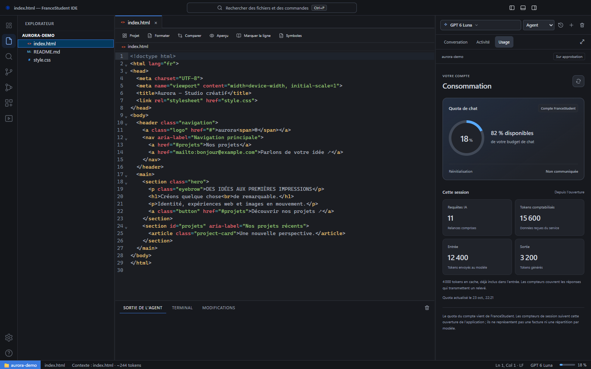

# Comprendre le quota et l’usage

[← Les guides](README.md) · [Mode Éco](eco-mode.md) · [Dépannage](depannage.md)

Clique sur la jauge dans la barre d’état ou sur l’onglet **Usage** pour ouvrir le détail.

## Lire les compteurs

| Indicateur | Ce qu’il représente |
| --- | --- |
| Quota de chat | La part du budget indiquée par FranceStudent |
| Requêtes IA | Les appels de la session, relances comprises |
| Tokens | Les compteurs reçus du service, ou une estimation signalée comme telle |
| Réinitialisation | L’échéance communiquée par le service, lorsqu’elle est disponible |

Les compteurs de session ne constituent pas une facture complète ni une répartition fiable par modèle. Un quota indisponible ne signifie pas qu’il est illimité.

## Quand le quota est épuisé

L’IDE affiche une carte explicative. Si l’API fournit une date, un compte à rebours indique le temps restant. Sans date fiable, l’application n’invente pas d’heure de reset.

**J’ai reçu un reset** relit l’état du compte : ce bouton ne remet pas lui-même le quota à zéro et ne relance pas la tâche. Une vérification silencieuse a lieu toutes les 15 minutes pendant l’ouverture de l’IDE.

## Éviter les envois inutilement lourds

- Joins les fichiers utiles à la demande, plutôt qu’un dossier entier.
- Précise les pages, feuilles ou éléments à examiner.
- Consulte l’avertissement avant un envoi volumineux.
- Essaie le [mode Éco](eco-mode.md) pour une demande courte.

Convertir et répartir des fichiers en lots ne rend pas leur consommation gratuite. La compaction gère le contexte, pas le budget de ton compte.
